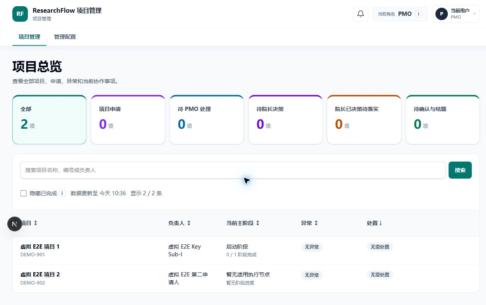
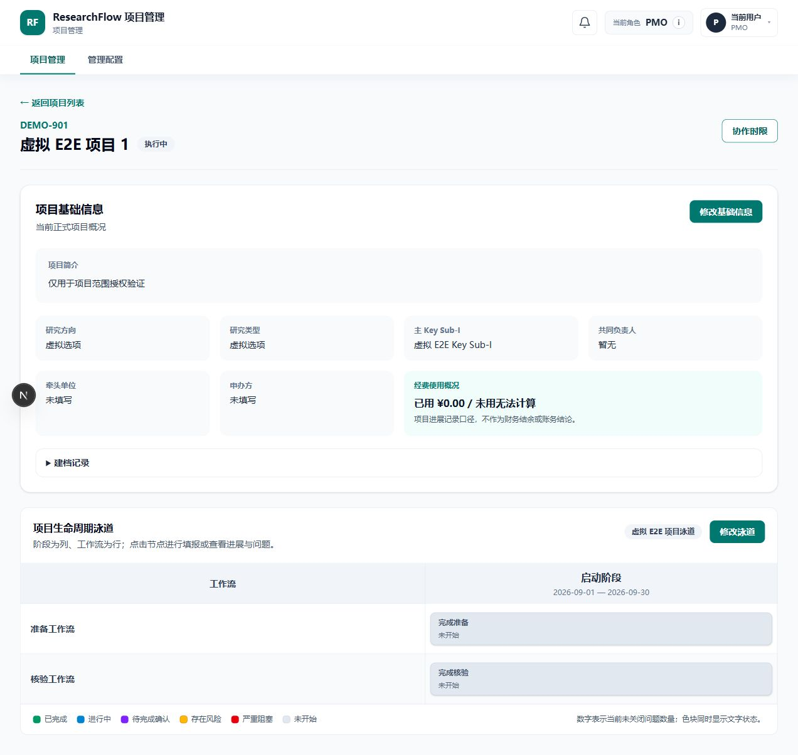

# ResearchFlow

[中文](README.md) · English

**A collaboration workflow system for research projects, from application and execution to closure.**

Project leads move work forward, the PMO reviews and coordinates, and managers handle escalated decisions. Application versions, node progress, issues, and review records stay connected to the same project.

Next.js · React · TypeScript · Prisma · PostgreSQL

## Screenshots

These are actual pages from this source running against an isolated local database with fictional accounts.

**Project overview:** The PMO views projects and pending work.

**Project execution:** Project details, stages, and workflow nodes appear on one page.

## Core workflow

Submit application → Review and establish project → Execute nodes → Review completion → Close and archive project

- **Traceable versions:** Submission freezes a version; returning it for revision preserves the original and creates an editable copy.
- **Dependencies in execution:** Swimlane nodes have prerequisites, and completion reviews check issues, attachments, and other conditions.
- **Defined responsibilities:** Project-scoped permissions, issue coordination, management decisions, and implementation feedback.
- **Recorded actions:** Progress corrections, audit records, and retryable background notifications.

## Further reading

- [Product walkthrough](docs/PRODUCT_WALKTHROUGH.en.md): Roles and business workflows.
- [Architecture](docs/ARCHITECTURE.en.md) / [Engineering guide](docs/ENGINEERING_GUIDE.en.md): Implementation, source references, and test evidence.
- [Fictional example](examples/README.en.md): A five-minute walkthrough.
- [Local validation guide](docs/LOCAL_VALIDATION.en.md): Environment requirements and check commands.

## Validation and data boundaries

2026-11-12: Type checks and builds passed, with **419 tests passed and 2 S3 tests skipped**. Migrations in an isolated database, PMO login, and screenshot-page checks were also completed. There are 4 remaining lint warnings and a file-type build warning. See the [validation record](docs/VALIDATION.en.md) for the exact scope.

The showcase uses fictional data and covers project-level workflows only. Real email, object storage, and business scenarios that were not exercised are not claimed as validated. No open-source license is included; see [Data safety and reuse](docs/DATA_AND_PUBLICATION.md).
