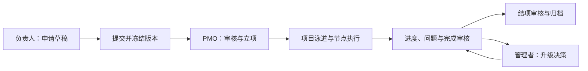

# ResearchFlow

**科研项目从申请、执行到结项的协作流程系统。**

ResearchFlow is a de-identified source showcase for research-project applications, versioned workflows, progress reviews, issue decisions, private attachments, and audit history.

系统围绕三个核心工作台展开：项目负责人提交与推进项目，项目办公室审核和协调，管理者查看总览并处理升级决策。它管理的是**项目级流程**，不收集患者、受试者或病历数据。

> 本仓库使用虚构示例与中性名称。它是可阅读、可构建的源码展示，不是已部署的在线演示；数据库集成与浏览器端到端流程尚未在此展示副本上验证。

## 先看什么

- [功能与业务流程](docs/PRODUCT_WALKTHROUGH.md)：角色、申请状态、执行与结项。
- [架构说明](docs/ARCHITECTURE.md)：Web、领域服务、Repository、数据库和 Worker 如何协作。
- [关键设计与代码导读](docs/ENGINEERING_GUIDE.md)：10 个可定位到源码与测试的设计点。
- [虚构案例讲解](examples/README.md)：用一个小项目串起完整故事，不依赖真实客户资料。
- [本地验证指南](docs/LOCAL_VALIDATION.md) / [实际验证结果](docs/VALIDATION.md)：如何复现检查，以及哪些还没有验证。
- [数据与复用边界](docs/DATA_AND_PUBLICATION.md)：脱敏范围、测试数据和许可证状态。

## 项目解决什么问题

一项研究项目通常同时涉及申请版本、阶段任务、负责人、审批意见、附件和异常处理。ResearchFlow 将这些记录组织为有状态、有权限边界、可追溯的工作流：

| 模块 | 源码实现的能力 |
| --- | --- |
| 申请与立项 | 草稿、提交冻结、退回后新版本、暂缓/恢复、驳回和事务内立项 |
| 工作流泳道 | 阶段与节点配置、负责人角色、日期、前置依赖和环检测 |
| 进度与完成审核 | 进度记录、追加式更正、完成申请、补充材料与审批门槛 |
| 问题与决策 | 问题上报、PMO 协调、升级决策、实施反馈和复核 |
| 附件 | 私有对象授权、元数据/类型/哈希核验、下载前重新校验权限 |
| 收尾与治理 | 结项、归档、通知中心、审计、字典与工作流方案配置 |

这些是系统实现描述，不是对个人贡献比例、生产效果或完整端到端验收的声明。详细证据见[代码导读](docs/ENGINEERING_GUIDE.md)。

## 核心流程

以下是源码流程示意，不是运行截图。退回、暂缓、撤回和异常分支见[业务流程](docs/PRODUCT_WALKTHROUGH.md)。



## 技术结构

- **Web：** Next.js App Router、React、TypeScript。
- **业务层：** 独立的认证授权、申请、协作、附件包；通过接口隔离持久化实现。
- **数据层：** Prisma + PostgreSQL；事务、约束、版本字段与审计记录。
- **后台任务：** 独立 Node.js Worker，处理通知 Outbox、提醒、附件清理与心跳。
- **检查：** Vitest、Playwright 测试源码、ESLint、TypeScript 与数据库契约/边界脚本。

这是一个分层 monorepo，不以包数量代表微服务数量。当前通知 Worker 仅装配 **capture 测试传输**，没有接入真实 SMTP 服务。

```text
apps/web                  页面、路由、服务端组合
apps/worker               后台任务与可中止执行循环
packages/auth             会话、凭证、授权策略
packages/project-application
                          申请与泳道校验
packages/collaboration    进度、问题、完成、结项、通知等
packages/attachments      附件策略与私有存储接口
packages/db               schema、迁移、Repository、数据库校验
e2e                       虚构数据浏览器场景源码
examples                  讲解用的虚构项目
```

## 验证状态

2026-11-12 重新执行的本地源码验证：

| 项目 | 结果 |
| --- | --- |
| Prisma 生成与 schema 校验 | 通过 |
| 工作区与 E2E 源码类型检查 | 通过 |
| 默认单元测试 | **419 通过，2 项 S3 测试跳过** |
| Lint | 0 错误，4 条导航方式警告 |
| 工作区 / Next.js 生产构建 | 通过，保留 1 条 file-type 动态依赖警告 |

**未执行：** 数据库迁移、数据库集成测试、浏览器 E2E、真实附件上传和真实邮件发送。构建成功不代表这些业务路径已经验收。完整范围见[验证记录](docs/VALIDATION.md)。

使用 Node.js 24 与 package.json 锁定的 pnpm。可先按[本地验证指南](docs/LOCAL_VALIDATION.md)完成不连接真实服务的检查；运行完整演示需要另行准备隔离数据库、对象存储和虚构账户。

## 数据与许可证

发布内容不包含客户资料、真实环境配置、生产部署材料、原 Git 历史、依赖目录或构建产物。示例 JSON 不是数据库 seed，也不包含可登录账户。

本仓库未附开源许可证。公开可读不等于授予任意复用许可；第三方依赖仍适用各自许可证。详见[数据与复用边界](docs/DATA_AND_PUBLICATION.md)。
