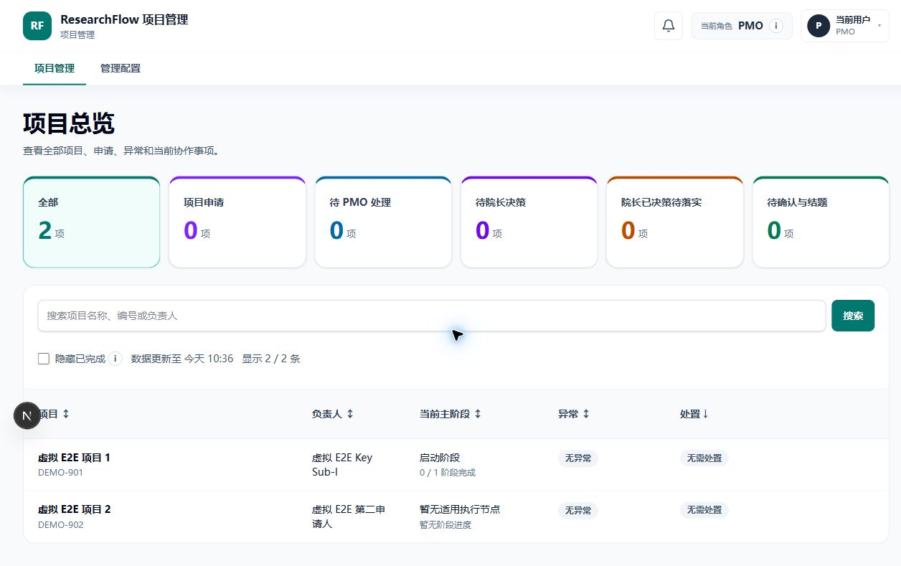
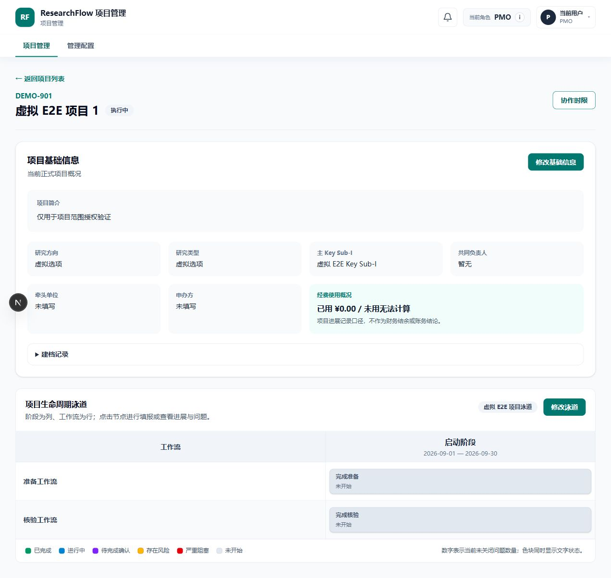

# ResearchFlow

**科研项目从申请、执行到结项的协作流程系统。**

项目负责人推进任务，PMO 审核与协调，管理者处理升级决策。申请版本、节点进度、问题和审批记录围绕同一个项目串联。

Next.js · React · TypeScript · Prisma · PostgreSQL

## 页面预览

以下为源码在独立本地数据库与虚构账户下运行的实际页面。

**项目总览：** PMO 查看项目与待处理事项。

**项目执行：** 项目基础信息、阶段和工作流节点放在同一页面。

## 核心流程

提交申请 → 审核立项 → 节点执行 → 完成审核 → 结项归档

- **版本可追溯：** 提交后冻结，退回后保留旧版并生成可编辑新版本。
- **执行有依赖：** 泳道节点包含前置关系，完成审核检查问题和附件等条件。
- **协作有分工：** 项目级权限、问题协调、管理者决策与实施反馈。
- **操作有记录：** 进度更正、审计与可重试的后台通知。

## 继续阅读

- [功能流程](docs/PRODUCT_WALKTHROUGH.md)：角色与业务路径。
- [架构](docs/ARCHITECTURE.md) / [工程导读](docs/ENGINEERING_GUIDE.md)：实现方式及源码、测试证据。
- [虚构案例](examples/README.md)：五分钟讲解路线。
- [本地验证指南](docs/LOCAL_VALIDATION.md)：环境要求与检查命令。

## 验证与数据边界

2026-11-12：类型检查和构建通过，**419 项测试通过，2 项 S3 测试跳过**。另已完成隔离库迁移、PMO 登录及截图页面检查。保留 4 条 lint 警告及 file-type 构建警告。完整覆盖范围见[验证记录](docs/VALIDATION.md)。

展示内容使用虚构数据，仅涉及项目级流程。真实邮件、对象存储与未执行的业务场景不作验证承诺。仓库未附开源许可证，详见[数据与复用边界](docs/DATA_AND_PUBLICATION.md)。
