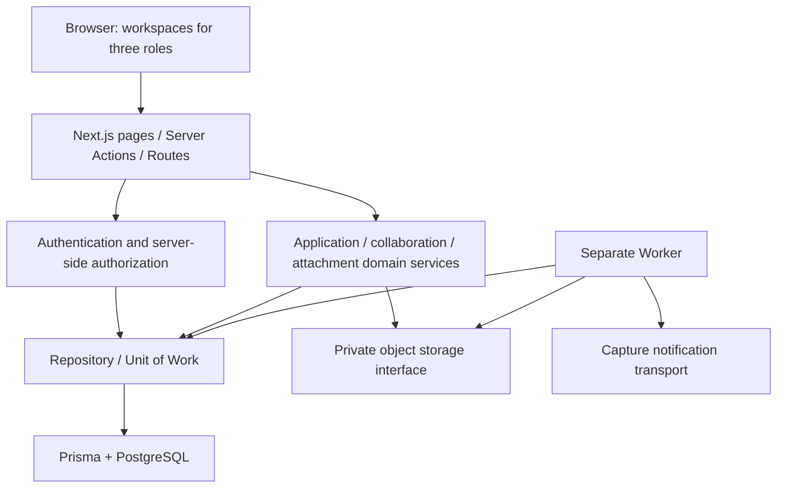

# Architecture

[中文](ARCHITECTURE.md) · English

[Overview](../README.en.md) · [Engineering evidence](ENGINEERING_GUIDE.en.md) · [Local validation](LOCAL_VALIDATION.en.md)

ResearchFlow is a layered TypeScript monorepo. The web application and background Worker are two runtime entry points, sharing domain packages and database implementations through workspace dependencies. The directories are not independently deployed microservices.

## 1. System structure

This diagram shows source-code dependencies, not infrastructure deployed as part of this showcase.

Pages handle presentation, while the server-side composition layer connects sessions, authorization, and business services. The domain layer defines input and state rules. Repositories handle query scope, transactions, concurrency, and audit writes. Attachment interfaces isolate object storage; knowing an object path does not grant the browser access to the associated business record.

## 2. Directory boundaries

| Location | Responsibility | Starting point |
| --- | --- | --- |
| apps/web | UI, request handling, and service composition | [Server directory](../apps/web/src/server) |
| apps/worker | Reminders, Outbox, cleanup, and heartbeat | [main.ts](../apps/worker/src/main.ts) |
| packages/auth | Sessions, passwords, roles, and project-scoped authorization | [authorization-service.ts](../packages/auth/src/authorization-service.ts) |
| packages/project-application | Application states, forms, and swimlane policies | [project-application-service.ts](../packages/project-application/src/project-application-service.ts) |
| packages/collaboration | Execution, issues, node completion, project closure, and governance | [Domain source](../packages/collaboration/src) |
| packages/attachments | Upload/download authorization, content checks, and storage interfaces | [attachment-service.ts](../packages/attachments/src/attachment-service.ts) |
| packages/db | Prisma client, repositories, migrations, and validation | [schema.prisma](../packages/db/prisma/schema.prisma) |

The [data-access boundary check](../packages/db/scripts/validate-data-access-boundary.mjs) constrains persistence dependencies. Separate packages help test rules in isolation, but do not imply that the business layer contains no infrastructure-related types.

## 3. How an application command reaches the database

A write operation such as submission or review follows this pattern:

1. The server receives the request, parses the input, and determines the current session and role.
2. The service checks permitted roles, required fields, and business policies.
3. The repository reads and locks the target project within a transaction, checking scope, state, and expectedRowVersion.
4. It writes the application version and related review/plan records, then appends activity, audit, and notification records.
5. It returns a new business snapshot; conflicts and validation failures are returned as business errors.

The application repository uses Serializable transactions and row locks. Commands also carry version and idempotency identifiers. These mechanisms address whether a group of writes completes together, whether a concurrent operation relies on stale state, and how duplicate commands are identified. They do not guarantee exactly-once execution across every concurrency failure or external side effect.

Evidence: [Application repository](../packages/db/src/project-application-repositories.ts), [application command contracts](../packages/project-application/src/repository-contracts.ts).

## 4. Data models represent distinct business facts

The current schema contains **91 model declarations**, and the showcase copy contains **25 migration directories**. These are static size counts, not quality or performance metrics.

| Model group | Facts stored |
| --- | --- |
| Person / Session / RoleAssignment | Accounts, sessions, roles, and project access relationships |
| ProjectApplicationVersion / ProjectEstablishmentReview | Submitted application versions and review feedback |
| ProjectPlanVersion / ProjectWorkflowStageVersion | Plan versions, stages, and node configuration |
| WorkflowUpdate / WorkflowUpdateCorrection | Original progress records and appended corrections |
| Issue / IssueDecisionRound / IssueImplementationSubmission | Issues, decision rounds, and implementation feedback |
| ProjectCompletionRequest / ProjectArchiveActivity | Project closure reviews and archive actions |
| FileAsset / BusinessAttachment / AttachmentUploadSession | File assets, business associations, and upload processes |
| NotificationOutbox / NotificationOutboxAttempt / AuditLog | Events awaiting delivery, attempt records, and audits |

The [Prisma schema](../packages/db/prisma/schema.prisma) and migration SQL define the complete relationships. The system handles project-level information only; it does not define patient, participant, medical-record, or CRF/EDC data models.

## 5. Versions, history, and constraints

- **Frozen applications:** Submitted versions are retained; a return for revision creates a new editable version.
- **Plan versions:** Execution plans and their corresponding node versions are stored separately, keeping templates distinct from project instances.
- **Progress corrections:** Appended records determine the effective view without erasing historical text.
- **Database constraints:** Migrations include constraints and triggers that supplement application-layer validation.
- **Migration integrity:** 24 historical migrations retain their original bytes. An additional showcase migration changes the code constraint for established projects to `DEMO-` followed by at least three digits, such as `DEMO-001`; projects not yet established still have no code. All 25 migrations have run against an isolated local demo database. The database integration suite and production upgrade paths remain unverified.

This design preserves several kinds of business history, but should not be described as a complete Event Sourcing architecture.

## 6. Worker and external dependencies

The [Worker entry point](../apps/worker/src/main.ts) registers tasks according to environment flags. The Outbox uses FOR UPDATE SKIP LOCKED for concurrent claiming, leases to handle ownership and expiry, and attempt records, backoff, and final-failure states to manage retries.

The current notification transport is [CaptureEmailTransport](../apps/worker/src/capture-email-transport.ts), which keeps messages in process memory for testing. It is not SMTP, an email provider, or a persistent inbox. Email delivery and database state updates also do not share a single external transaction, so exactly-once delivery cannot be claimed.

Attachments use an S3-compatible private storage interface. The application compares upload declarations with detected content and reauthorizes access before issuing a download URL. File-type and hash checks are not antivirus scanning, comprehensive DLP, or compliance certification.

## 7. Validation boundaries

See the [validation record](VALIDATION.en.md) for local type-check, unit-test, and build results. Database integration and Playwright scenario source files provide entry points for future validation, not evidence of completed runs. This document makes no claims about high availability, production throughput, recovery time, or real-world business outcomes.
