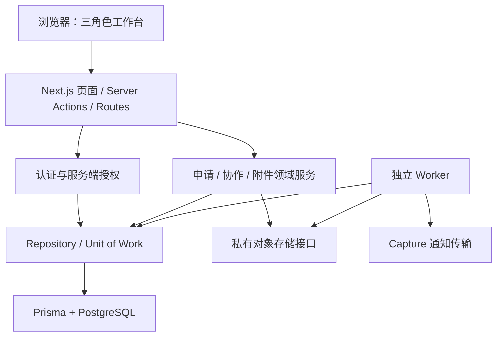

# 架构说明

[返回首页](../README.md) · [设计证据](ENGINEERING_GUIDE.md) · [本地验证](LOCAL_VALIDATION.md)

ResearchFlow 是一个分层 TypeScript monorepo。Web 与后台 Worker 是两个运行入口，领域包和数据库实现通过工作区依赖复用；它不是由每个目录独立部署的微服务集群。

## 1. 系统结构

以下为源码依赖示意，不代表本次已经部署的基础设施。

页面负责呈现，服务端组合层把会话、授权和业务服务接起来。领域层表达输入和状态规则；Repository 负责查询范围、事务、并发与审计写入。对象存储由附件接口隔离，浏览器不能凭一个对象路径取得业务访问权。

## 2. 目录边界

| 位置 | 责任 | 阅读入口 |
| --- | --- | --- |
| apps/web | UI、请求处理与服务组合 | [服务端目录](../apps/web/src/server) |
| apps/worker | 提醒、Outbox、清理与心跳 | [main.ts](../apps/worker/src/main.ts) |
| packages/auth | 会话、密码、角色与项目范围授权 | [authorization-service.ts](../packages/auth/src/authorization-service.ts) |
| packages/project-application | 申请状态、表单与泳道策略 | [project-application-service.ts](../packages/project-application/src/project-application-service.ts) |
| packages/collaboration | 执行、问题、完成、结项与治理 | [领域源码](../packages/collaboration/src) |
| packages/attachments | 上传/下载授权、内容检查与存储接口 | [attachment-service.ts](../packages/attachments/src/attachment-service.ts) |
| packages/db | Prisma client、Repository、迁移与校验 | [schema.prisma](../packages/db/prisma/schema.prisma) |

[数据访问边界检查](../packages/db/scripts/validate-data-access-boundary.mjs)用于约束持久化依赖边界。包拆分有助于单独测试规则，但不意味着业务层完全不含基础设施相关类型。

## 3. 一次申请命令如何落库

以提交/审核这一类写操作为例：

1. 请求进入服务端，解析输入并确定当前会话与角色。
2. 服务层检查允许的角色、必要字段和业务策略。
3. Repository 在事务中读取并锁定目标项目，检查范围、状态与 expectedRowVersion。
4. 写入申请版本、审核/计划等关联记录，并追加活动、审计和相关通知记录。
5. 返回新的业务快照；冲突或校验失败按业务错误返回。

申请 Repository 使用 Serializable 事务和行锁，命令中也携带版本与幂等标识。它们分别处理“这一组写入能否一起完成”“并发操作是否基于过时状态”和“重复命令如何识别”。这不是对所有并发异常或外部副作用都恰好执行一次的保证。

依据：[申请 Repository](../packages/db/src/project-application-repositories.ts)、[申请命令契约](../packages/project-application/src/repository-contracts.ts)。

## 4. 数据模型按业务事实拆分

当前 schema 有 **91 个 model 声明**，展示副本有 **25 个迁移目录**。这只是静态规模描述，不是质量或性能指标。

| 模型组 | 保存的事实 |
| --- | --- |
| Person / Session / RoleAssignment | 账户、会话、角色与项目访问关系 |
| ProjectApplicationVersion / ProjectEstablishmentReview | 被提交的申请版本和审核意见 |
| ProjectPlanVersion / ProjectWorkflowStageVersion | 计划版本、阶段和节点配置 |
| WorkflowUpdate / WorkflowUpdateCorrection | 原始进度与追加更正 |
| Issue / IssueDecisionRound / IssueImplementationSubmission | 问题、决策轮次与实施反馈 |
| ProjectCompletionRequest / ProjectArchiveActivity | 结项审核与归档动作 |
| FileAsset / BusinessAttachment / AttachmentUploadSession | 文件资产、业务关联与上传过程 |
| NotificationOutbox / NotificationOutboxAttempt / AuditLog | 待投递事件、尝试记录和审计 |

完整关系以 [Prisma schema](../packages/db/prisma/schema.prisma)及迁移 SQL 为准。系统只处理项目级信息，不设计患者、受试者、病历或 CRF/EDC 数据模型。

## 5. 版本、历史和约束

- **申请冻结：** 已提交版本保留；退回时生成新可编辑版本。
- **计划版本：** 执行计划与相应节点版本分开保存，避免把模板和项目实例混为一谈。
- **进度更正：** 通过追加记录计算有效视图，不把历史文本直接擦掉。
- **数据库约束：** 迁移中包含约束和触发器，补充应用层校验。
- **迁移完整性：** 24 条历史迁移保留原字节；新增展示迁移将已立项项目编号约束调整为 `DEMO-` 加至少三位数字（如 `DEMO-001`）；未立项项目编号仍为空。25 条迁移已在独立本地演示库执行；数据库集成套件与生产升级路径仍未验证。

这种设计保留了多种业务历史，但不应称为完整的 Event Sourcing 架构。

## 6. Worker 与外部依赖

[Worker 入口](../apps/worker/src/main.ts)按环境开关注册任务。Outbox 通过 FOR UPDATE SKIP LOCKED 并发领取，使用租约处理占用与超时，通过尝试记录、退避和最终失败状态管理重试。

当前通知传输是 [CaptureEmailTransport](../apps/worker/src/capture-email-transport.ts)，消息保存在进程内，用于测试。它不是 SMTP、邮件供应商或持久化收件箱。邮件发送与数据库状态更新也不处于同一个外部事务中，不能声称 exactly-once delivery。

附件使用 S3-compatible 私有存储接口。应用会核对上传声明与检测结果，并在发放下载地址前重新授权。文件类型和哈希检查不是病毒扫描、完整 DLP 或合规认证。

## 7. 验证边界

本地类型、单元测试和构建结果见[验证记录](VALIDATION.md)。数据库集成与 Playwright 场景源码提供后续验证入口，不是已执行结果。本文不主张高可用性、生产吞吐、恢复时间或真实业务收益。
