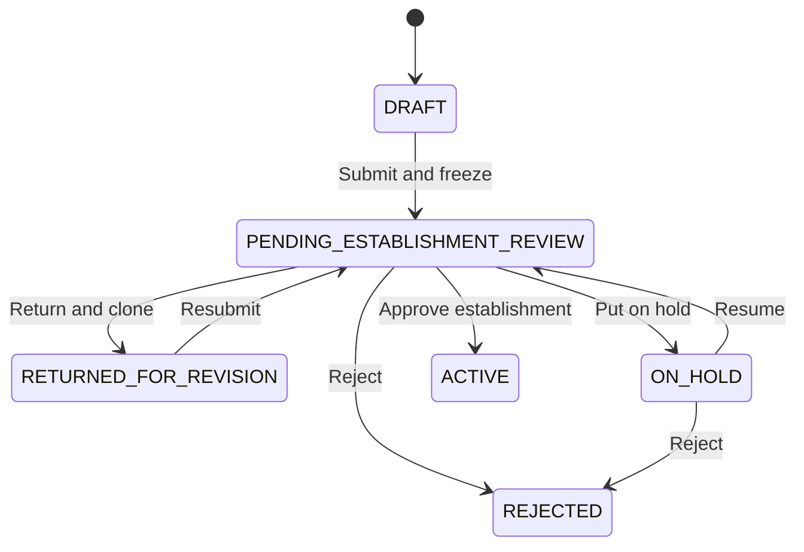

# Features and workflows

[中文](PRODUCT_WALKTHROUGH.md) · English

[Overview](../README.en.md) · [Architecture](ARCHITECTURE.en.md) · [Fictional example](../examples/README.en.md)

This document describes behavior found in the public source code, for code reading and project presentations. The diagrams illustrate the design; they are not records of browser testing performed on this showcase copy.

## 1. Who uses the system

| Role | Code | Main workspace and responsibilities |
| --- | --- | --- |
| Project lead | KEY_SUB_I | My projects, applications and revisions, progress, issue reporting, node completion requests, and project closure requests |
| Project management office | PMO | Project reviews, coordination and follow-up reviews, configuration, account roles, and archiving |
| Manager | DEAN | Project overview, decisions on escalated issues, and implementation reviews |

The current workspace navigation explicitly supports these three roles. Domain types also include CRC, STATISTICIAN, and COLLABORATION_LEAD, but their presence alone does not establish that they have complete, separate workspaces.

Evidence: [Workspace navigation](../apps/web/src/components/workspace/workspace-navigation.ts), [authorization service](../packages/auth/src/authorization-service.ts).

## 2. Applications: from editable drafts to frozen review versions

The project lead enters basic project information, research area, type, lead, and swimlane plan. Submission validates personnel eligibility and plan structure as well as form fields.

- **Draft DRAFT:** Stores an editable application.
- **Awaiting review PENDING_ESTABLISHMENT_REVIEW:** Freezes the submitted version, which becomes the subject of review.
- **Returned RETURNED_FOR_REVISION:** PMO provides feedback; the system retains the old version and clones a new editable version.
- **On hold ON_HOLD:** Pauses the current review; resuming returns it to the pending state.
- **Established ACTIVE:** Approval creates formal records including the project code, plan, and nodes.
- **Rejected REJECTED / withdrawn CANCELLED:** Ends the corresponding application process while retaining activity records.

The diagram focuses on the main review path and does not enumerate every branch, such as withdrawal. The existence of two states does not mean a transition between them is allowed. Actual operations are constrained by role, current version, review records, and concurrency version checks.

**Presentation point:** Why retain the original application when returning it for revision? The reviewer's original evidence must remain distinguishable from the applicant's later changes.

Evidence: [Application service](../packages/project-application/src/project-application-service.ts), [state definitions](../packages/project-application/src/contracts.ts), [application repository](../packages/db/src/project-application-repositories.ts).

## 3. Workflow after establishment: stages, nodes, and dependencies

A project plan contains stages, workflows, nodes, and dependencies. Nodes can specify roles, dates, update intervals, and attachment requirements. Prerequisite relationships form a directed graph.

Source-code checks cover missing references, duplicate IDs, self-dependencies, invalid dates, and cycles. These checks help keep invalid plans out of subsequent reviews; they do not constitute a complex resource scheduler or automatic optimization engine.

Evidence: [Swimlane policy](../packages/project-application/src/swimlane-policy.ts), [swimlane service](../packages/collaboration/src/project-swimlane-service.ts).

## 4. Progress and completion: separate records, corrections, and approvals

1. The project lead records a progress summary, supporting information, expected completion date, and optional monetary amounts.
2. A correction appends a new record with a reason rather than overwriting the original progress entry.
3. The project lead submits a node completion request. Supplementing, withdrawing, and resubmitting are separate operations.
4. PMO review still considers prerequisite nodes, unresolved issues, and required attachments.
5. Revoking formal completion is a restricted operation that requires a reason and a concurrency version.

Recording progress, requesting completion, and formally completing a node are different facts. This document does not collapse them into a single completion checkbox.

Evidence: [Progress service](../packages/collaboration/src/workflow-progress-service.ts), [progress persistence](../packages/db/src/workflow-progress-repositories.ts), [completion service](../packages/collaboration/src/workflow-completion-service.ts).

## 5. Issue coordination and management decisions

The project lead can associate execution issues with project nodes. After receiving an issue, PMO adds coordination records, requests more information, or submits a resolution. When a higher-level decision is needed, PMO states the decision question explicitly and escalates it.

Once a manager records a decision, PMO can submit implementation results, followed by an implementation review when needed. Issue records, decision rounds, and implementation feedback are retained separately rather than replaced by a single final summary.

Evidence: [Issue service](../packages/collaboration/src/issue-service.ts), [issue repository](../packages/db/src/issue-repositories.ts).

## 6. Attachments, notifications, and audits throughout the workflow

- Attachments are associated with business objects. Upload completion triggers server-side checks, and downloads require a fresh check of current permissions.
- The notification center and Outbox store pending events. Background tasks claim them, retry processing, and record failures.
- The current Worker only uses an in-memory capture transport. It supports checks of notification content and idempotent behavior, but does not prove that real email was delivered.
- Audit records explain who performed a particular type of business action and when. They must not be described as a certified, tamper-proof audit system.

Evidence: [Attachment service](../packages/attachments/src/attachment-service.ts), [notification background implementation](../packages/db/src/notification-worker-repositories.ts), [Worker entry point](../apps/worker/src/main.ts).

## 7. Project closure and archiving

The project lead checks closure readiness before submitting closure materials and confirmations. PMO can return the request for additional information or approve it, after which the project can be archived. Archiving and restoring an archived project have separate permission, reason, and version requirements.

Node completion, project closure, and archiving are three distinct levels. None substitutes for the other two.

Evidence: [Closure service](../packages/collaboration/src/project-closure-service.ts), [closure repository](../packages/db/src/project-closure-repositories.ts).

## How to label evidence in a presentation

- **Source implementation:** Follow the links above to inspect functions and constraints.
- **Local checks passed:** Use only the dates and scope listed in the [validation record](VALIDATION.en.md).
- **Environment validation still required:** Database integration, object storage, multi-role browser workflows, and email services.
- **Personal experience:** Individual responsibilities, team contributions, business outcomes, and performance figures require separate records and cannot be inferred from this code.
