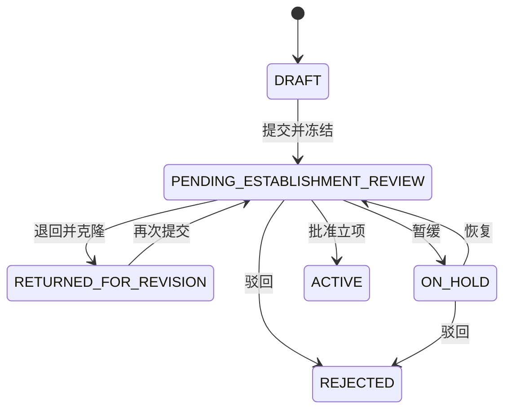

# 功能与业务流程

[返回首页](../README.md) · [架构](ARCHITECTURE.md) · [虚构案例](../examples/README.md)

本文根据公开源码描述行为，供阅读代码或讲解项目使用。流程图是设计示意，未作为此展示副本的浏览器实测记录。

## 1. 谁使用系统

| 角色 | 代码 | 主要入口与职责 |
| --- | --- | --- |
| 项目负责人 | KEY_SUB_I | 我的项目、申请与修改、进度、问题上报、完成和结项申请 |
| 项目办公室 | PMO | 项目审核、协调与复核、配置、账号角色、归档 |
| 管理者 | DEAN | 项目总览、被升级问题的决策及实施复核 |

当前工作台导航明确支持这三个角色。领域类型还包含 CRC、STATISTICIAN、COLLABORATION_LEAD，不能仅据此声称它们有完整独立工作台。

依据：[工作台导航](../apps/web/src/components/workspace/workspace-navigation.ts)、[授权服务](../packages/auth/src/authorization-service.ts)。

## 2. 申请：从可编辑草稿到冻结审核版本

负责人填写项目基本信息、研究方向、类型、负责人以及泳道计划。提交时不仅检查表单，还要校验人员资格与计划结构。

- **草稿 DRAFT：** 保存可编辑申请。
- **待审 PENDING_ESTABLISHMENT_REVIEW：** 提交的版本被冻结，审核针对这一份版本进行。
- **退回 RETURNED_FOR_REVISION：** PMO 提供意见，系统保留旧版本并克隆出新可编辑版本。
- **暂缓 ON_HOLD：** 暂停当前审核；恢复后回到待审。
- **立项 ACTIVE：** 审核通过后建立项目编号、计划与节点等正式记录。
- **驳回 REJECTED / 撤回 CANCELLED：** 结束相应申请流程，保留活动记录。

图中聚焦审核主线，未穷举撤回等分支。状态存在不意味着任意两种状态都可互转；实际操作受角色、当前版本、审核记录与并发版本约束。

**讲解重点：** 为什么退回时不直接覆盖原申请？因为需要区分“审核者当时看到的内容”和“申请人后来修改的内容”。

依据：[申请服务](../packages/project-application/src/project-application-service.ts)、[状态定义](../packages/project-application/src/contracts.ts)、[申请 Repository](../packages/db/src/project-application-repositories.ts)。

## 3. 立项后的工作流：不是一张平面任务清单

项目计划由阶段、工作流、节点和依赖关系组成。节点可以配置角色、日期、更新间隔和附件要求；前置关系形成一张有向图。

源码校验包括引用是否存在、ID 是否重复、是否自依赖、日期是否合法以及是否成环。它帮助阻止无效计划进入后续审核，但不等同于复杂资源排程或自动优化引擎。

依据：[泳道策略](../packages/project-application/src/swimlane-policy.ts)、[泳道服务](../packages/collaboration/src/project-swimlane-service.ts)。

## 4. 进度与完成：记录、更正和审批分开

1. 负责人记录进度摘要、依据、预计完成日期及可选的金额记录。
2. 需要修正时，追加带原因的更正记录，不覆盖原始进度。
3. 负责人提交节点完成申请；补充、撤回、重新提交是独立操作。
4. PMO 审核时仍要考虑前置节点、未解决问题和必需附件等门槛。
5. 正式完成的撤销属于受限操作，需要原因和并发版本。

“已填报进度”“提交完成申请”“正式完成”是不同事实，文档不把它们合并为一个完成勾选框。

依据：[进度服务](../packages/collaboration/src/workflow-progress-service.ts)、[进度持久化](../packages/db/src/workflow-progress-repositories.ts)、[完成服务](../packages/collaboration/src/workflow-completion-service.ts)。

## 5. 问题协调与管理者决策

负责人可以把执行问题关联到项目节点。PMO 接收问题后补充协调记录、请求补充或提交解决结果；需要更高层决策时，提交明确的决策问题并升级。

管理者记录决策后，PMO 可以提交实施结果，必要时再进行实施复核。问题记录、决策轮次和实施反馈分别保留，不用一段最终文字覆盖全过程。

依据：[问题服务](../packages/collaboration/src/issue-service.ts)、[问题 Repository](../packages/db/src/issue-repositories.ts)。

## 6. 附件、通知和审计贯穿流程

- 附件与业务对象关联，上传完成时进行服务器侧核验，下载前再次检查当前权限。
- 通知中心与 Outbox 保存待处理事件；后台任务领取、重试并记录失败。
- 当前 Worker 只装配内存 capture 传输，适合检查通知内容与幂等行为，不会证明真实邮件已送达。
- 审计记录用于解释谁在何时执行了哪一类业务动作，不能被描述为经过认证的不可篡改审计系统。

依据：[附件服务](../packages/attachments/src/attachment-service.ts)、[通知后台实现](../packages/db/src/notification-worker-repositories.ts)、[Worker 入口](../apps/worker/src/main.ts)。

## 7. 结项与归档

负责人先检查结项准备条件，再提交结项材料与确认项。PMO 可以退回补充或批准，之后进行归档；归档与恢复归档有单独的权限、理由和版本要求。

节点完成、项目结项、归档是三个层次，不能用其中一个替代其余两个。

依据：[结项服务](../packages/collaboration/src/project-closure-service.ts)、[结项 Repository](../packages/db/src/project-closure-repositories.ts)。

## 讲解时如何标注证据

- **源码实现：** 可以沿上述链接查看函数与约束。
- **本地检查已通过：** 仅采用[验证记录](VALIDATION.md)列出的日期与范围。
- **仍需环境验证：** 真实数据库、对象存储、浏览器多角色流程与邮件服务。
- **个人经历：** 作者职责、团队分工、业务效果与性能数字需另有记录，不能从当前代码推断。
